# Lumiere - Women's Sleepwear Store

**Student name:** DJEBIR Raounak

## Description

Lumiere is a small online store for women's sleepwear. Users can look at products, filter them, add them to a cart, and save favorites. It is made with React and Redux. There is no backend or payment system.

## Technologies Used

- React 18
- Redux and React-Redux
- React Router
- Vite
- Tailwind CSS
- Node.js and npm

## Main React Components

- App: sets all the pages (routes)
- Layout: header and footer shown on every page
- ProductCard: shows one product
- ProductImage: shows a product picture
- Stars: shows the star rating
- Pages: Home, Shop, Product, Cart, Checkout, Account, Admin, Info

## Redux State

The Redux store keeps:

- cart: the products the user added
- favorites: the products the user liked
- user: the logged in user

## Features

- Product list with images, prices, and ratings
- Search, sort, and filters (price, category, size, color)
- Add and remove products from the cart
- Favorites (heart button)
- Sign in and create account (demo, saved in the browser)
- Responsive design

## How to Run

1. Install Node.js.
2. Download the project:

```
git clone https://github.com/raw-djb/TP2-WAMD-React-Application.git
cd TP2-WAMD-React-Application
```

3. Install the packages:

```
npm install
```

4. Start the app:

```
npm run dev
```

5. Open the link shown in the terminal (usually http://localhost:5173).

## Screenshots

### Home
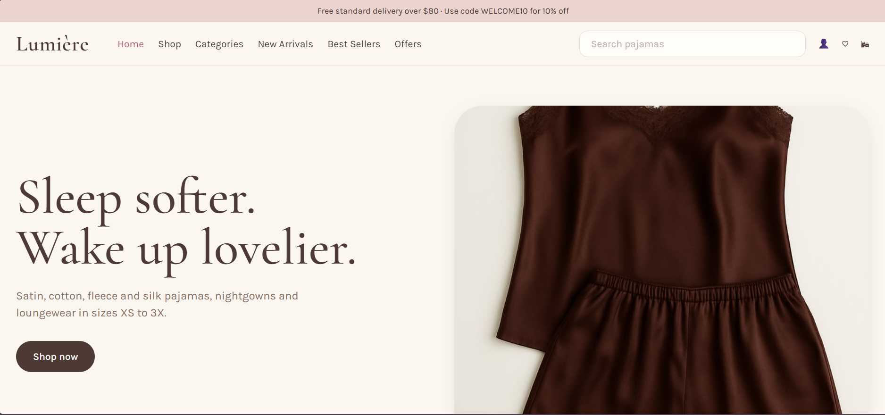

### Categories
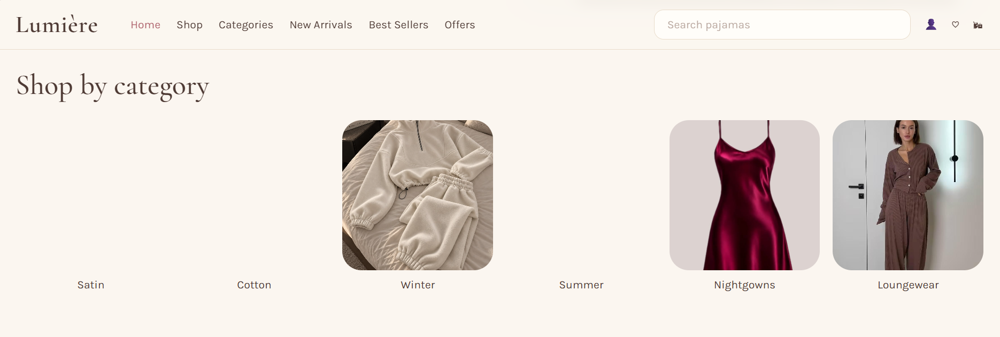

### New Arrivals
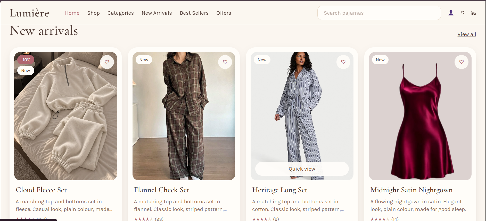

### Offers
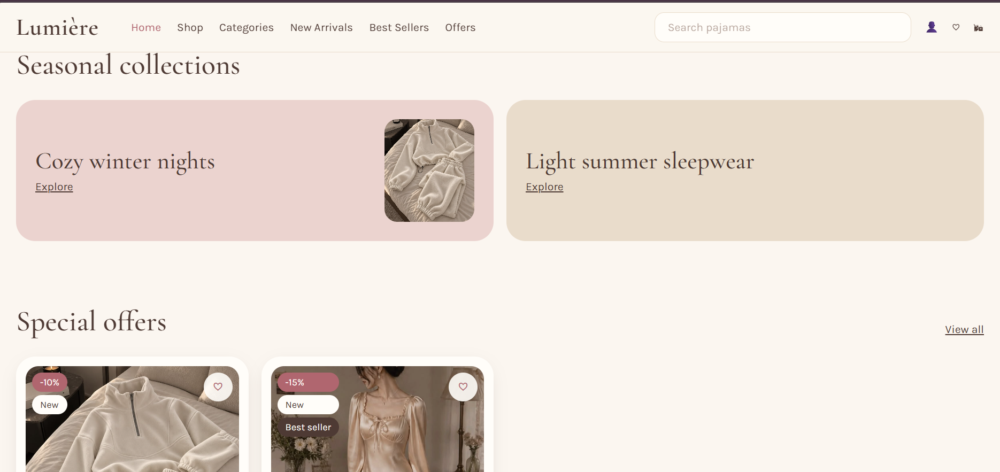

### Collections and Reviews
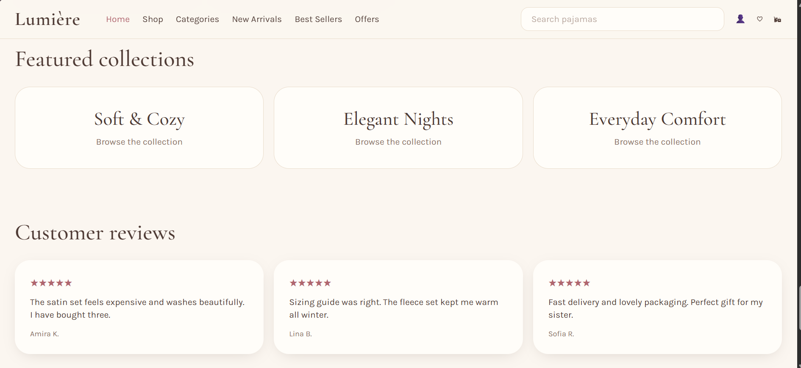

### Footer
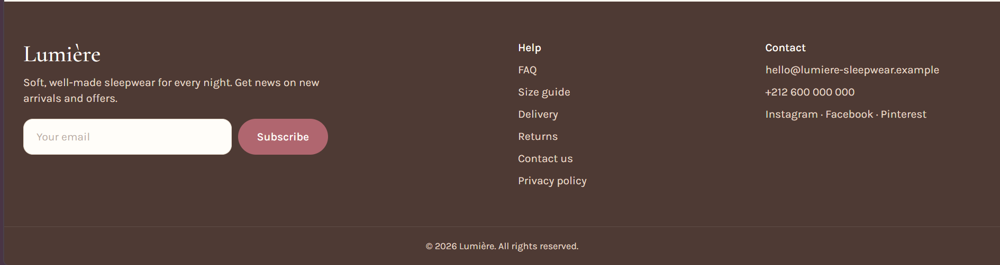

### Shop
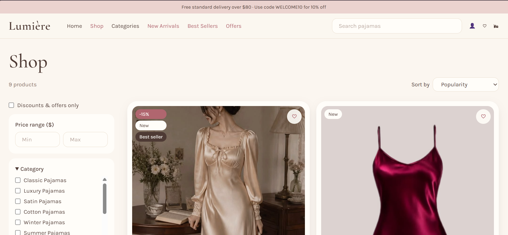

### Filters
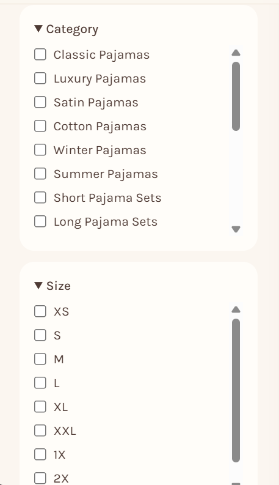

### Products and Colors
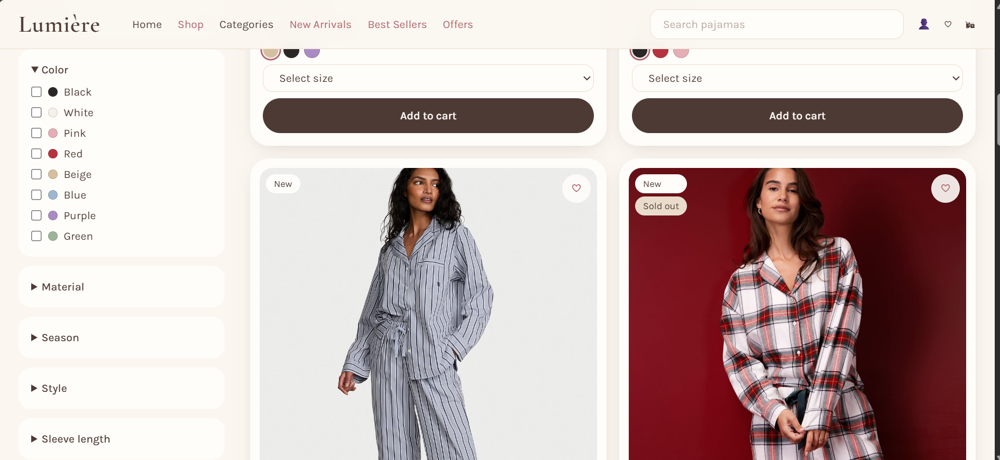

### Sign In
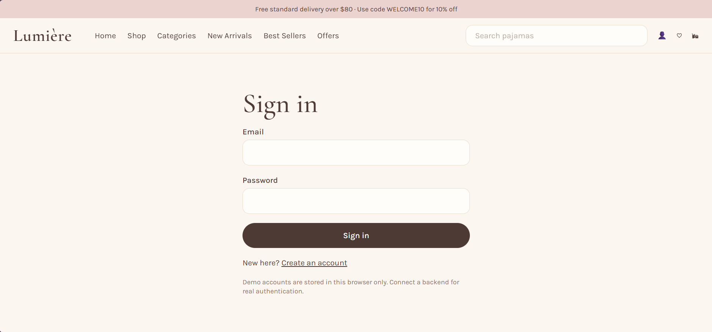

### Create Account
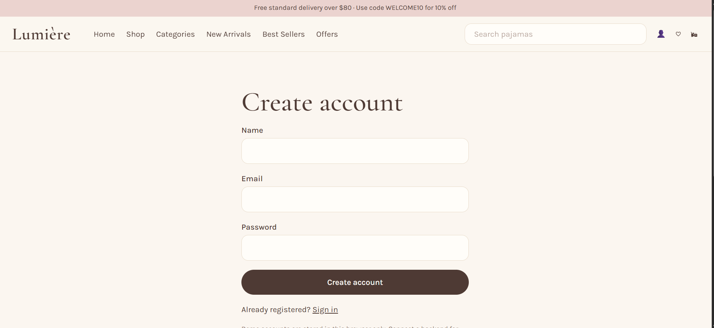